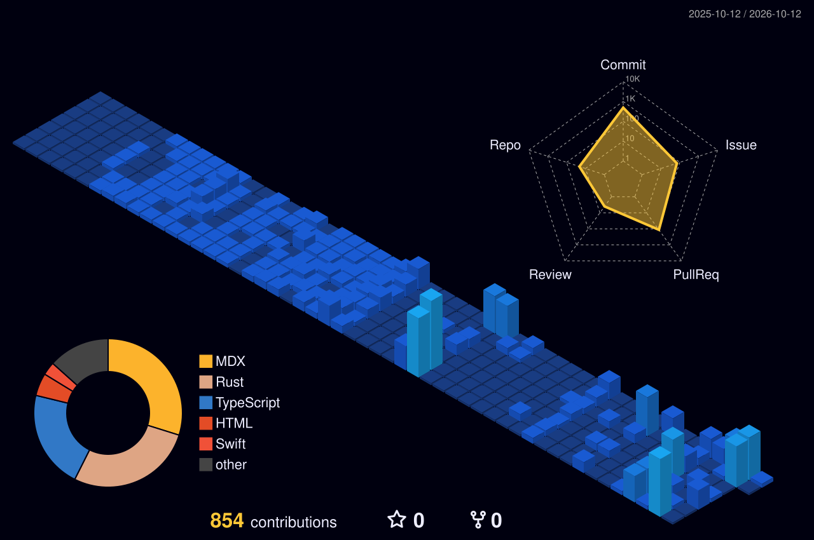

<div align="center">



[](https://git.io/typing-svg)

[](https://github.com/developjik)
[](https://developjik-nextra-blog.vercel.app)
[](https://developjik.notion.site/0f0b9f81e6f745d2bc11ee9ddefb068c)
[](https://www.linkedin.com/in/developjik/)
[](mailto:developjik@gmail.com)

</div>

---

## 👋 About

에이전트와 데스크톱 도구를 만드는 개발자 **developjik**입니다.  
프론트엔드(React · TypeScript)로 시작해, 지금은 **Rust + Tauri**로 로컬에서 도는 제품과 **사람 대신 일하는 AI 에이전트**를 만듭니다. 반복되는 일은 에이전트에게, 설계는 사람에게 — 그 원칙으로 매일 배포합니다.

```rust
struct Developjik {
    base: &'static str,        // Seoul
    stack: Vec<&'static str>,  // rust · tauri · typescript · python
    thesis: &'static str,      // 사람은 설계하고, 에이전트가 일한다
    shipping: Vec<Project>,    // confluence-studio · damon · ai-note · …
}
```

---

## 🚀 Now Shipping

<div align="center">
<table>
<tr>
<td width="50%" valign="top">

### [confluence-studio](https://github.com/developjik/confluence-studio)

Confluence Cloud를 위한 네이티브 데스크톱 워크스페이스. Markdown 편집, 예약 export, AI 챗을 하나의 앱으로.

**[▶ 랜딩 페이지](https://developjik.github.io/confluence-studio/)**

`Tauri 2` `Rust` `React 19` `AI Chat`

</td>
<td width="50%" valign="top">

### [damon-agent-core](https://github.com/developjik/damon-agent-core)

멀티프로바이더 AI 에이전트 코어 — 하나의 데몬으로 모든 서피스를 커버. 첫 서피스는 [damon-chat-desk](https://github.com/developjik/damon-chat-desk).

`Rust` `Agent Runtime` `Multi-Provider`

</td>
</tr>
<tr>
<td width="50%" valign="top">

### [ai-note](https://github.com/developjik/ai-note)

로컬 퍼스트 AI 노트 앱. Tantivy 기반 한글 검색과 git 버전 레이어를 얹은 Tauri 데스크톱.

`Rust` `Tantivy` `Local-first`

</td>
<td width="50%" valign="top">

### [assignment-map](https://github.com/developjik/assignment-map)

AI가 만들어 제출하는 모든 기회 — 채용 과제·해커톤·공모전·대회를 매일 추적하는 데이터 리포 + GitHub Pages 대시보드.

`Data Pipeline` `GitHub Pages` `Automation`

</td>
</tr>
</table>
</div>

---

## 🧭 More Work

- **[nextra-blog](https://github.com/developjik/nextra-blog)** — Next.js 16 + Nextra 기술 블로그 · Pagefind · Giscus → [블로그](https://developjik-nextra-blog.vercel.app)
- **[notify-action-hub](https://github.com/developjik/notify-action-hub)** — Slack/Discord/Telegram 알림 + action metadata 검증 자동화 허브
- **[plugin](https://github.com/developjik/plugin) · [plugin-tools](https://github.com/developjik/plugin-tools)** — Codex · Claude Code 플러그인/스킬 실험 워크스페이스
- **[confluence-export-desktop](https://github.com/developjik/confluence-export-desktop)** — 예약 실행되는 Confluence export Windows GUI
- **아카이브** — [Classy](https://github.com/developjik/Classy) (WebRTC 실시간 수업 플랫폼) · [Bootcamp](https://github.com/developjik/developjik-bootcamp-archives) · [ExamY](https://github.com/developjik/developjik-examy-archives)

---

## 🛠 Stack

<div align="center">
<br/><br/>

</div>

---

## 💡 How I Work

- **Agents that ship** — AI를 코드 자동완성이 아니라 기획 → 구현 → 리뷰 → 배포까지 담당하는 개발 워크플로로 씁니다. 이 프로필도 제 에이전트(dinobot)가 꾸몄습니다.
- **Local-first** — 데이터는 내 맥에, 오프라인에서도 도는 데스크톱 제품을 지향합니다.
- **Automate the repeat** — 반복되는 수동 작업은 GitHub Actions, 스크립트, 데스크톱 앱으로 없앱니다.

---

## 🏆 GitHub Achievements

<div align="center">
  <a href="https://github.com/developjik?tab=achievements">
    
    
    
    
  </a>
  <p><sub><b>Pull Shark x3 · Pair Extraordinaire · Quickdraw · YOLO</b></sub></p>
</div>

---

## 📊 Stats

<div align="center">
  
  
</div>

<div align="center">
  
</div>

<div align="center">
<picture>
  <source media="(prefers-color-scheme: dark)" srcset="https://raw.githubusercontent.com/developjik/developjik/output/github-contribution-grid-snake-dark.svg" />
  <source media="(prefers-color-scheme: light)" srcset="https://raw.githubusercontent.com/developjik/developjik/output/github-contribution-grid-snake.svg" />
  
</picture>
</div>



---

<div align="center">

**사람은 설계하고, 에이전트는 일한다.**

<sub>✦ 이 프로필은 제가 만든 에이전트 dinobot이 꾸몄습니다 — 배너, 문안, 통계 카드 모두.</sub>

</div>
