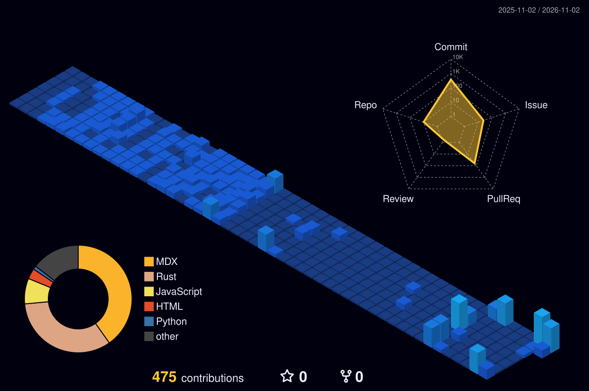

<div align="center">



[](https://git.io/typing-svg)

[](https://github.com/developjik)
[](https://developjik-nextra-blog.vercel.app)
[](https://developjik.notion.site/0f0b9f81e6f745d2bc11ee9ddefb068c)
[](https://www.linkedin.com/in/developjik/)
[](mailto:developjik@gmail.com)

</div>

---

## 👋 About

에이전트와 데스크톱 도구를 만드는 개발자 **developjik**입니다.  
**Frontend Developer × AI Agent Builder** — React 19와 TypeScript로 사용자 경험(UI/UX)을 설계하고, **Rust + Tauri 2**로 로컬 네이티브 제품과 **백그라운드에서 자율 주행하는 AI 에이전트 런타임**을 만듭니다. 반복되는 일은 에이전트에게, 인터랙션과 설계는 사람에게 — 그 원칙으로 매일 배포합니다.

```rust
struct Developjik {
    role: &'static str,        // Frontend Developer × AI Agent Builder
    base: &'static str,        // Seoul
    stack: Vec<&'static str>,  // react-19 · typescript · rust · tauri-2 · python
    thesis: &'static str,      // 사람은 설계하고, 에이전트가 일한다
    shipping: Vec<Project>,    // confluence-studio · damon · developjik.dev · assignment-map
}
```

---

## 🚀 Now Shipping

<div align="center">
<table>
<tr>
<td width="50%" valign="top">

### [confluence-studio](https://github.com/developjik/confluence-studio)

Confluence Cloud를 위한 네이티브 데스크톱 워크스페이스. React 19 동시성 에디터와 Damon AI 스트리밍 사이드킥이 결합된 AI Native 제품.

**[▶ 랜딩 페이지](https://developjik.github.io/confluence-studio/)**

`Tauri 2` `Rust` `React 19` `AI Agent`

</td>
<td width="50%" valign="top">

### [damon-agent-core](https://github.com/developjik/damon-agent-core)

멀티프로바이더 AI 에이전트 통합 런타임 — 단일 데몬으로 모든 서피스(CLI/Desktop/Web) 커버. crates.io & npm 배포.

`Rust` `Agent Runtime` `JSON-RPC v2` `crates.io / npm`

</td>
</tr>
<tr>
<td width="50%" valign="top">

### [developjik.dev](https://github.com/developjik/developjik.dev)

Astro 5 + Tailwind CSS 4로 구축한 기술 블로그. MDX 72편 중 '프론트엔드 AI 실무' 플레이북 24편 연재 · Pagefind 검색.

**[▶ 블로그 읽기](https://developjik-nextra-blog.vercel.app)**

`Astro 5` `MDX` `Tailwind CSS 4`

</td>
<td width="50%" valign="top">

### [assignment-map](https://github.com/developjik/assignment-map)

AI가 만들어 제출하는 모든 기회 — 채용 과제·해커톤·공모전·대회를 매일 추적하는 데이터 리포 + GitHub Pages 대시보드.

`Data Pipeline` `GitHub Pages` `Automation`

</td>
</tr>
</table>
</div>

---

## 🧭 More Work

- **[plugin](https://github.com/developjik/plugin)** — Codex · Claude Code 전용 에이전트 킷(DevX, Frontend, Contract 등 6종) & 하네스 설계
- **[notify-action-hub](https://github.com/developjik/notify-action-hub)** — Slack/Discord/Telegram 알림 + action metadata 검증 자동화 허브
- **[confluence-export-desktop](https://github.com/developjik/confluence-export-desktop)** — 예약 실행되는 Confluence export Windows GUI
- **아카이브** — [Classy](https://github.com/developjik/Classy) (WebRTC 실시간 수업 플랫폼) · [Bootcamp](https://github.com/developjik/developjik-bootcamp-archives) · [ExamY](https://github.com/developjik/developjik-examy-archives)

---

## 🛠 Stack

<div align="center">
<br/><br/>

</div>

---

## 💡 How I Work

- **Agents that ship** — AI를 단순 코드 자동완성이 아니라 기획 → 구현 → 리뷰 → 배포까지 담당하는 자율 에이전트 파이프라인으로 씁니다.
- **Local-first & Native Performance** — 사용자 데이터는 로컬에 안전하게 보관하고, Electron 대비 5배 가벼운 Tauri 2 데스크톱 제품을 지향합니다.
- **Automate the repeat** — 반복되는 수동 작업은 GitHub Actions, 스크립트, 데스크톱 앱으로 완전히 없앱니다.

---

## 🏆 GitHub Achievements

<div align="center">
  <a href="https://github.com/developjik?tab=achievements">
    
    
    
    
  </a>
  <p><sub><b>Pull Shark x3 · Pair Extraordinaire · Quickdraw · YOLO</b></sub></p>
</div>

---

## 📊 Stats

<div align="center">
  
  
</div>

<div align="center">
  
</div>

<div align="center">
<picture>
  <source media="(prefers-color-scheme: dark)" srcset="https://raw.githubusercontent.com/developjik/developjik/output/github-contribution-grid-snake-dark.svg" />
  <source media="(prefers-color-scheme: light)" srcset="https://raw.githubusercontent.com/developjik/developjik/output/github-contribution-grid-snake.svg" />
  
</picture>
</div>



---

<div align="center">

**사람은 설계하고, 에이전트는 일한다.**

<sub>✦ Frontend Developer × AI Agent Builder · developjik</sub>

</div>
