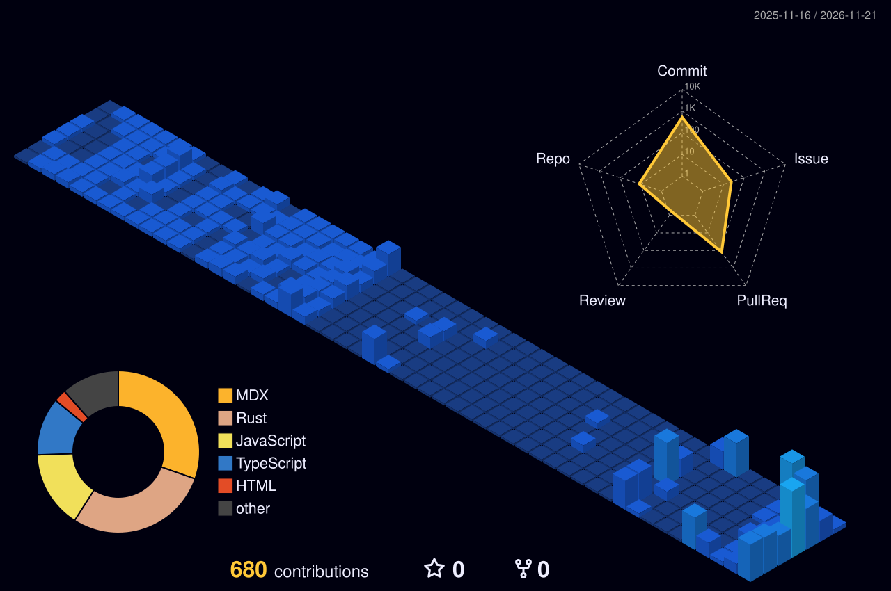

<div align="center">



[](https://git.io/typing-svg)

[](https://github.com/developjik)
[](https://developjik-nextra-blog.vercel.app)
[](https://developjik.notion.site/0f0b9f81e6f745d2bc11ee9ddefb068c)
[](https://www.linkedin.com/in/developjik/)
[](mailto:developjik@gmail.com)

</div>

---

## 👋 About

에이전트와 데스크톱 도구를 만드는 개발자 **developjik**입니다.  
**Frontend Developer × AI Agent Builder** — React 19와 TypeScript로 사용자 경험(UI/UX)을 설계하고, **Rust + Tauri 2**로 로컬 네이티브 제품과 **백그라운드에서 자율 주행하는 AI 에이전트 런타임**을 만듭니다. 반복되는 일은 에이전트에게, 인터랙션과 설계는 사람에게 — 그 원칙으로 매일 배포합니다.

```rust
struct Developjik {
    role: &'static str,        // Frontend Developer × AI Agent Builder
    base: &'static str,        // Seoul
    stack: Vec<&'static str>,  // react-19 · typescript · rust · tauri-2 · python
    thesis: &'static str,      // 사람은 설계하고, 에이전트가 일한다
    shipping: Vec<Project>,    // damon · confluence-studio · assignment-map · developjik.dev
}
```

---

## 🚀 Now Shipping

<div align="center">
<table>
<tr>
<td width="50%" valign="top">

### [Damon](https://github.com/developjik/damon-agent-core) — 하나의 데몬, 모든 서피스

Rust로 만든 로컬 에이전트 제어 데몬. Claude Code · Codex CLI · Qwen Code 등 **9종 코딩 에이전트 CLI**를 각자의 양방향 프로토콜로 구동하고, 세션·권한 승인 중계·SQLite FTS5 전문검색 이력·Telegram/Discord/Slack 채널을 데몬 하나가 맡습니다. 웹·CLI·데스크톱은 그 위의 얇은 클라이언트입니다.

**[damon-agent-core](https://github.com/developjik/damon-agent-core)** · **[홈페이지](https://developjik.github.io/damon-agent-core/)** · crates.io `damon-core` 0.8.0 · npm `damon-agent` 0.8.0

웹 서피스 **[damon-chat-desk](https://github.com/developjik/damon-chat-desk)** — Vite + React 19 정적 SPA. 메시지 단위 프로바이더 스위처, 같은 프롬프트를 두 모델에 동시 발사하는 비교 모드, 툴 결과 뷰어 · 진행 중 턴 방향 수정(turn.steer) · 계획 승인 카드 · 턴 분기, 메모리 원장 CRUD, 대화 내보내기(Markdown/JSON). 데몬 없이 체험하는 데모 모드 내장.

`Rust` `JSON-RPC v2` `SQLite FTS5` `React 19`

</td>
<td width="50%" valign="top">

### [confluence-studio](https://github.com/developjik/confluence-studio)

Confluence Cloud를 Markdown 손맛으로 다루는 네이티브 데스크톱 워크스페이스. Tauri 2 + Rust + React 19 — 스페이스 트리, CodeMirror 6 Markdown 에디터, storage XHTML ↔ Markdown 양방향 변환, 예약 export 잡(5종 스케줄 · sha256 건너뛰기 · 실행 이력), OS 키체인 자격증명, Damon 스트리밍 AI 사이드킥. Confluence 계정 없이 화면을 먼저 보는 브라우저 데모 모드.

**[▶ 랜딩 페이지](https://developjik.github.io/confluence-studio/)**

`Tauri 2` `Rust` `React 19` `CodeMirror 6`

</td>
</tr>
<tr>
<td width="50%" valign="top">

### [assignment-map](https://github.com/developjik/assignment-map)

AI로 만들어 제출하는 기회 — 채용 과제·해커톤·대회·공모전·밋업을 매일 03:00 KST에 수집해, AI 사용을 금지하지 않는 것만 정책 근거 문장과 함께 공개하는 데이터 리포 + 정적 대시보드. 지금 200건 넘게 추적 중. 키보드 중심 표, 우측 상세 패널, 마감 캘린더, `.ics` 내보내기, RSS/JSON 피드, 자체 안티-슬롭 린터. 운영비 ₩0.

**[▶ 대시보드](https://developjik.github.io/assignment-map/)**

`React 18` `Rollup` `GitHub Actions` `GitHub Pages`

</td>
<td width="50%" valign="top">

### [developjik.dev](https://github.com/developjik/developjik.dev)

Astro 5 + Tailwind CSS 4로 다시 지은 기술 블로그. MDX 73편, 그중 '이직에 바로 먹히는 프론트엔드 AI 실무' 시리즈 24편. Pagefind 전문 검색과 ⌘K 커맨드 팔레트, 포스트별 OG 이미지 자동 생성, 시리즈·태그·아카이브 뷰.

**[▶ 블로그 읽기](https://developjik-nextra-blog.vercel.app)**  
최근 글 — [AI 과제 지도(assignment-map) 구축기](https://developjik-nextra-blog.vercel.app/posts/assignment-map-build-log/)

`Astro 5` `MDX` `Tailwind CSS 4` `Pagefind`

</td>
</tr>
</table>
</div>

---

## 🧭 More Work

- **[plugin](https://github.com/developjik/plugin)** — Claude Code · Codex · Cursor용 에이전트 킷 6종(프론트엔드 기본기, DevX, 구현 계약, 제품 정의, 지속 학습, 업무 산출물) & 하네스 설계
- **[notify-action-hub](https://github.com/developjik/notify-action-hub)** — Slack/Discord/Telegram 알림 + action metadata 검증 자동화 허브
- **[confluence-export-desktop](https://github.com/developjik/confluence-export-desktop)** — 예약 실행되는 Confluence export Windows GUI (PySide6)
- **아카이브** — [Classy](https://github.com/developjik/Classy) (WebRTC 실시간 수업 플랫폼) · [Bootcamp](https://github.com/developjik/developjik-bootcamp-archives) · [ExamY](https://github.com/developjik/developjik-examy-archives)

---

## 🛠 Stack

<div align="center">
<br/><br/>

</div>

---

## 💡 How I Work

- **Agents that ship** — AI를 단순 코드 자동완성이 아니라 기획 → 구현 → 리뷰 → 배포까지 담당하는 자율 에이전트 파이프라인으로 씁니다.
- **Local-first & Native Performance** — 사용자 데이터는 로컬에 안전하게 보관하고, Electron 대신 **Tauri 2(Rust 코어 + 웹 UI)** 로 가벼운 데스크톱 제품을 만듭니다.
- **Automate the repeat** — 매일 도는 데이터 수집, 예약 export, 알림·검증 워크플로처럼 반복되는 수동 작업은 GitHub Actions와 데스크톱 앱으로 없앱니다.

---

## 🏆 GitHub Achievements

<div align="center">
  <a href="https://github.com/developjik?tab=achievements">
    
    
    
    
  </a>
  <p><sub><b>Pull Shark x3 · Pair Extraordinaire · Quickdraw · YOLO</b></sub></p>
</div>

---

## 📊 Stats

<div align="center">
  
  
</div>

<div align="center">
  
</div>

<div align="center">
<picture>
  <source media="(prefers-color-scheme: dark)" srcset="https://raw.githubusercontent.com/developjik/developjik/output/github-contribution-grid-snake-dark.svg" />
  <source media="(prefers-color-scheme: light)" srcset="https://raw.githubusercontent.com/developjik/developjik/output/github-contribution-grid-snake.svg" />
  
</picture>
</div>



---

<div align="center">

**사람은 설계하고, 에이전트는 일한다.**

<sub>✦ Frontend Developer × AI Agent Builder · developjik</sub>

</div>
